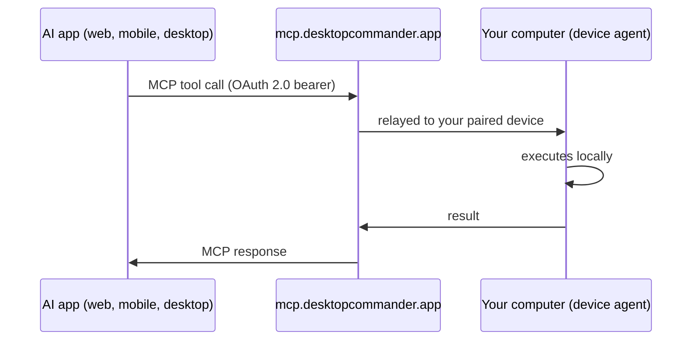

# Remote Desktop Commander


**Build, explore, automate on your computer — from anywhere.**

Reach your computer's filesystem and terminal from any AI app that supports remote MCP connectors. Remote Desktop Commander is a hosted [MCP](https://modelcontextprotocol.io) server that relays a secure connection to your real machine, giving your AI assistant the same full file and shell access as the local server — without you needing to be at the keyboard.

- **Server endpoint:** `https://mcp.desktopcommander.app/mcp` (Streamable HTTP, OAuth 2.0)
- **Dashboard:** [mcp.desktopcommander.app](https://mcp.desktopcommander.app)
- **Status:** currently in beta
- **Demo:** [watch the video](https://youtu.be/C2kH5itFsGg)

[](cursor://anysphere.cursor-deeplink/mcp/install?name=remote-desktop-commander&config=eyJ1cmwiOiAiaHR0cHM6Ly9tY3AuZGVza3RvcGNvbW1hbmRlci5hcHAvbWNwIn0=)

> This repository hosts the public manifests, documentation and issue tracker for the hosted service. The service implementation is not open source. For the open-source local (stdio) server, see [DesktopCommanderMCP](https://github.com/wonderwhy-er/DesktopCommanderMCP).

## What you can do

- **Build from scratch** — create features and applications with simple commands
- **Manage development environments** — set up servers, configure systems, handle processes
- **Explore existing codebases** — navigate and understand complex repositories
- **Edit documents in place** — work on Word, Excel, and PDF files where they live on disk
- **Manage context and documentation** — keep track of project details and technical specifications
- **Control multiple machines** — pair several computers and address them by name in one conversation

## Quick start

### 1. Start the device agent

On the computer you want to control:

```bash
npx @wonderwhy-er/desktop-commander@latest remote
```

Your browser opens to a verification page showing a pairing code (also printed in the terminal — a standard OAuth device-flow check). Sign in, confirm the codes match, and the terminal reports "Device ready". Keep the agent running: close the terminal, no access.

### 2. Connect your AI client

Each client walks you through OAuth sign-in on first connect.

**claude.ai / Claude Desktop** — Settings → Connectors → **Add custom connector**, then enter:

```
https://mcp.desktopcommander.app/mcp
```

**Claude Code:**

```bash
claude mcp add --transport http remote-desktop-commander https://mcp.desktopcommander.app/mcp
```

(If you work inside a checkout of this repo, Claude Code also picks up the included [`.mcp.json`](.mcp.json) automatically.)

**ChatGPT** — Settings → Apps & Connectors → Advanced settings → enable **Developer mode** (requires a plan that includes it), then **Create connector** and enter:

```
https://mcp.desktopcommander.app/mcp
```

**Cursor** — one click: [**Add to Cursor**](cursor://anysphere.cursor-deeplink/mcp/install?name=remote-desktop-commander&config=eyJ1cmwiOiAiaHR0cHM6Ly9tY3AuZGVza3RvcGNvbW1hbmRlci5hcHAvbWNwIn0=). Or add to `~/.cursor/mcp.json` manually:

```json
{
  "mcpServers": {
    "remote-desktop-commander": {
      "url": "https://mcp.desktopcommander.app/mcp"
    }
  }
}
```

**VS Code** — install the agent plugin (bundles this server):

```bash
copilot plugin install desktop-commander/remote-desktop-commander
```

Or add the server directly to `.vscode/mcp.json` in your workspace (or your user-level `mcp.json`):

```json
{
  "servers": {
    "remote-desktop-commander": {
      "type": "http",
      "url": "https://mcp.desktopcommander.app/mcp"
    }
  }
}
```

**Gemini CLI:**

```bash
gemini extensions install https://github.com/desktop-commander/remote-desktop-commander
```

### 3. Try it

These work against any machine running the agent, no setup needed:

> "List the contents of my home directory and tell me what's there."
>
> "Create a folder called ai-test in my Documents folder. Inside it, write a short Python script that prints the date, and run it."
>
> "Start a Python REPL on my machine, import pandas, and tell me which version is installed. Keep the session alive."
>
> "Search my home directory for files modified in the last 24 hours and group them by folder."

Full walkthrough with troubleshooting: [docs/SETUP.md](docs/SETUP.md)

## Requirements

- Node.js 18 or newer (for `npx`) on each computer you want to control
- One terminal running the device agent per machine
- Works on **macOS, Windows, and Linux**

## Available tools

| Category | Tools |
|---|---|
| **Read & explore** | Read File, Read Multiple Files, List Directory, Get File Info |
| **Search** | Start Search, Get More Search Results, Stop Search, List Active Searches |
| **Write & edit** | Write File, Edit File Block, Move or Rename File, Create Directory, Write or Modify PDF |
| **Terminal & processes** | Start Process, Send Input to Process, Read Process Output, List Active Sessions, List System Processes, Terminate Session, Kill System Process |
| **Devices & account** | List Paired Devices, Current User Info, Ping Device, Shutdown Device Agent |
| **Configuration & help** | Get Configuration, Set Configuration Value, Get Prompt Library, Get Recent Tool Activity, Get Usage Statistics, Submit Feedback |

## How it works



- Authentication is standard **OAuth 2.0 with PKCE**; devices pair via the OAuth **device authorization flow** (the short-code approval you see at setup).
- The server only accesses data explicitly requested through tool calls; transmission is encrypted in transit (HTTPS/TLS).
- A machine is reachable **only while its device agent is running** — stop it with `Ctrl+C` and access ends. Devices can also be reviewed and revoked at any time from the [dashboard](https://mcp.desktopcommander.app).
- Tools execute with **your user account's permissions** on the paired machine, so treat your connected AI accounts like credentials and protect them with MFA. Read the full trust model in [SECURITY.md](SECURITY.md).

## Support & legal

- **Setup guide:** [docs/SETUP.md](docs/SETUP.md)
- **Bugs & feature requests:** [GitHub Issues](https://github.com/desktop-commander/remote-desktop-commander/issues) · **Contributing:** [CONTRIBUTING.md](CONTRIBUTING.md)
- **Community:** [Discord](https://discord.gg/kQ27sNnZr7)
- **Security reports:** see [SECURITY.md](SECURITY.md)
- **Privacy policy:** [Remote Desktop Commander privacy policy](https://legal.desktopcommander.app/#/remote_privacy_policy) · **Terms of service:** [legal.desktopcommander.app](https://legal.desktopcommander.app/#/terms_of_service)
- **License:** [LICENSE](LICENSE) — this repository holds docs and manifests only; the hosted service is proprietary

## Related

- [DesktopCommanderMCP](https://github.com/wonderwhy-er/DesktopCommanderMCP) — the open-source local MCP server (npm: [`@wonderwhy-er/desktop-commander`](https://www.npmjs.com/package/@wonderwhy-er/desktop-commander)), which also ships the `remote` device agent used for pairing
- [desktopcommander.app](https://desktopcommander.app) — product site
